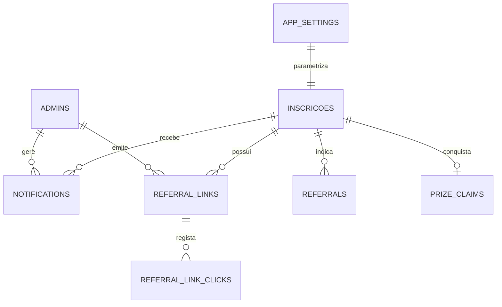

# Documentação Técnica do Painel Administrativo — Imersão WEX

## 1. Escopo e Conclusão

O painel administrativo do projeto **Imersão WEX — Woman Experience** evoluiu de um protótipo estático preliminar (`dashboard.html` com Alpine.js e simulação local) para uma **aplicação moderna, reativa e segura** desenvolvida em **React 19 + TypeScript + Vite**, estilizada com **Tailwind CSS 4** e integrada ao **Supabase (PostgreSQL 15)** como fonte única de verdade (*Single Source of Truth*).

Diferente do protótipo legado que operava com arrays em memória e chaves isoladas no `localStorage`:
- O painel administrativo principal é servido na rota protegida `/admin` e gerido pelo componente [`AdminPanel.tsx`](file:///e:/wex/src/pages/AdminPanel.tsx).
- Existe um portal operacional autónomo para a equipa de receção no dia do evento, servido na rota `/checkin` e gerido por [`CheckInPage.tsx`](file:///e:/wex/src/pages/CheckInPage.tsx), equipado com **sincronização offline via IndexedDB**.
- A persistência, regras de negócio e validações são asseguradas diretamente na base de dados PostgreSQL através de **Row Level Security (RLS)**, gatilhos (*triggers*) e **Stored Procedures (RPC)**.

---

## 2. Rotas e Pontos de Entrada

A navegação da aplicação é controlada pelo **React Router v7** ([`App.tsx`](file:///e:/wex/src/App.tsx)). Todas as rotas públicas e administrativas partilham o mesmo ecossistema compilado:

| Rota / Caminho | Componente Principal | Função / Descrição |
|---|---|---|
| `/admin` | [`AdminPanel.tsx`](file:///e:/wex/src/pages/AdminPanel.tsx) | Painel de controlo geral da organização (métricas, participantes, referrals, prémios, check-in e definições). |
| `/checkin` | [`CheckInPage.tsx`](file:///e:/wex/src/pages/CheckInPage.tsx) | Portal móvel/tablet para a equipa da porta no dia do evento (pesquisa rápida, confirmação e modo offline). |
| `/` ou `/moderna` | [`ModernaPage.tsx`](file:///e:/wex/src/pages/ModernaPage.tsx) | Landing page oficial moderna (versão 2026) com formulário público de inscrição e mentoria. |
| `/caverna` | [`CavernaPage.tsx`](file:///e:/wex/src/pages/CavernaPage.tsx) | Variação temática da landing page (design Caverna/Intimista). |
| `/classico` | `MainPage` em [`App.tsx`](file:///e:/wex/src/App.tsx) | Landing page com estética clássica Mulheres de Fogo. |
| `/convite` | [`ConvitePage.tsx`](file:///e:/wex/src/pages/ConvitePage.tsx) | Página pública personalizada para participantes convidadas via link de referral com tracking de origem. |
| `/termos` | [`TermosPage.tsx`](file:///e:/wex/src/pages/TermosPage.tsx) | Termos de participação, tratamento de dados e política de privacidade do evento. |

### Navegação Interna do Painel Administrativo (`/admin`)

Dentro de [`AdminPanel.tsx`](file:///e:/wex/src/pages/AdminPanel.tsx), a navegação entre secções é controlada pelo estado reativo `activeTab: AdminTab`, alternado pela barra lateral [`AdminSidebar.tsx`](file:///e:/wex/src/components/admin/AdminSidebar.tsx):

- `dashboard`: Visão analítica, funil de conversão, tendências e canais de tráfego.
- `checkin`: Monitor em tempo real do evento com métricas de presença, reversão e exportação.
- `ranking`: Classificação das participantes que mais convidadas trouxeram e apuração do pódio.
- `notifications`: Fila de notificações para envio manual/automático via WhatsApp e E-mail.
- `participants`: Tabela de inscritas com pesquisa, filtros avançados, modal de ficha completa, notas e exportação Excel.
- `prizes`: Gestão dos prémios do pódio (Bíblia, Agenda e T-shirt) e vencedoras associadas.
- `settings`: Controlo mestre de abertura de inscrições, link do grupo WhatsApp e contactos.

---

## 3. Áreas do Painel e Perfis de Acesso

### Perfis e Autenticação

A autenticação é gerida nativamente pelo Supabase Auth através de [`auth.ts`](file:///e:/wex/src/lib/auth.ts) e validada na tabela `admins`:

- **Validação de Credenciais**: `signInAdmin(email, password)` valida a senha com hash criptográfico no Supabase Auth e confirma se o `auth.uid()` existe na tabela `admins`.
- **Proteção contra Força Bruta**: O formulário bloqueia tentativas repetidas em intervalo inferior a 5 segundos.
- **Isolamento de Dados (RLS)**: As políticas SQL garantem que utilizadores não autenticados ou sem registo na tabela `admins` recebem erro `not_authorized` nas consultas às tabelas e funções RPC.

### Módulos do Painel

| ID da Tab | Módulo | Funcionalidades Principais | Perfis |
|---|---|---|---|
| `dashboard` | Dashboard Analítico | Funil de 4 etapas, gráfico de tendência diária (SVG), aquisição por canais (Donut SVG), cliques por dia da semana (Bar SVG), insights automatizados e leaderboard top 5. | `admin`, `super_admin` |
| `checkin` | Gestão de Check-in | Percentagem de presença em tempo real, total de presentes vs ausentes, barra de progresso animada, botão de desfazer check-in e exportação XLSX. | `admin`, `super_admin` |
| `ranking` | Pódio de Convidadoras | Ranking ordenado por `convidadas_count`, destaque visual para o Top 3 (1º Bíblia, 2º Agenda, 3º T-shirt) e botão transacional para fechar o pódio (`assign_podium_prizes`). | `admin`, `super_admin` |
| `notifications` | Central de Notificações | Registo de notificações geradas pelo sistema com links rápidos formatados para `wa.me` (WhatsApp) e `mailto:` (E-mail), com marcação de estado enviado. | `admin`, `super_admin` |
| `participants` | Base de Participantes | Pesquisa multifatorial, filtros por pódio, links adicionais e estado de adesão ao grupo WhatsApp; seleção múltipla para envio em lote; modal detalhado com histórico de links e cliques; exportação Excel (.xlsx). | `admin`, `super_admin` |
| `prizes` | Gestão de Prémios | Critérios detalhados de premiação, regras de negócio e atribuição automática às vencedoras do pódio. | `admin`, `super_admin` |
| `settings` | Definições da Campanha | Interruptor master de ativação/fecho de inscrições públicas, parametrização do link de convite do grupo oficial de WhatsApp, detalhes do evento e canais de suporte. | `admin`, `super_admin` |
| Portal `/checkin` | App da Porta (Staff) | Interface touch otimizada para telemóveis e tablets, identificação do operador (*staff*), pesquisa com tolerância a acentos (`unaccent`), fila offline (*IndexedDB*) e feedback háptico. | Operador autenticado |

---

## 4. Estrutura de UI e Componentes

A arquitetura do painel está modularizada em componentes React reutilizáveis dentro de `src/components/admin/`:

### 4.1. Página mestre e navegação

- [`AdminPanel.tsx`](file:///e:/wex/src/pages/AdminPanel.tsx): Página mestre do painel — autenticação, orquestração de estado, todos os *handlers* e chamadas Supabase, cabeçalho, encaminhamento das *tabs* e dos modais.
- [`AdminSidebar.tsx`](file:///e:/wex/src/components/admin/AdminSidebar.tsx): Navegação lateral responsiva (desktop + drawer mobile). Detém a **fonte única de verdade** da navegação (`NAV_ITEMS`, tipo `AdminTab`) e expõe `getTabLabel()` / `getTabIcon()`, usados pelo cabeçalho para derivar o título — elimina a antiga lista de rótulos duplicada.
- [`constants.ts`](file:///e:/wex/src/components/admin/constants.ts): Constantes partilhadas (`PODIUM_PRIZES`, `ParticipantFilter`).

### 4.2. Primitivas de design (`src/components/admin/ui/`)

Sistema de design partilhado que garante consistência visual em todo o painel:

| Ficheiro | Componentes | Função |
|---|---|---|
| `ui/Button.tsx` | `Button` | Variantes `primary` / `secondary` / `success` / `danger` / `ghost`, tamanhos `sm` / `md`, estado `loading` e `icon`. |
| `ui/Card.tsx` | `Card`, `SectionTitle`, `StatCard`, `EmptyState` | Cartões, títulos de secção, cartões de métrica (com barra de progresso) e estados vazios. |
| `ui/Badge.tsx` | `Badge` | Etiquetas com tons `cyan` / `success` / `warning` / `danger` / `info` / `neutral`. |
| `ui/PageHeader.tsx` | `PageHeader` | Cabeçalho de página (ícone + título + descrição + acções). |
| `ui/Modal.tsx` | `Modal`, `fieldClasses`, `labelClasses` | Modal acessível (**fecha com `Escape`, `role="dialog"`, `aria-modal`, botão com `aria-label`**) e classes reutilizáveis de campos. |
| `ui/index.ts` | — | Barrel export. |

### 4.3. Secções extraídas do monólito

Componentes que viviam embutidos em `AdminPanel.tsx` e foram extraídos para ficheiros próprios. **Todo o estado e todas as chamadas Supabase permanecem em `AdminPanel.tsx`**, passando para baixo apenas via *props*:

- [`ParticipantsSection.tsx`](file:///e:/wex/src/components/admin/ParticipantsSection.tsx): Tabela/cartões de participantes com pesquisa, filtros e seleção múltipla.
- [`ParticipantModal.tsx`](file:///e:/wex/src/components/admin/ParticipantModal.tsx): Ficha completa da participante (cadastro, links, cliques, notas internas, notificações).
- [`RankingSection.tsx`](file:///e:/wex/src/components/admin/RankingSection.tsx): Pódio e ranking de convidadoras.
- [`NotificationsSection.tsx`](file:///e:/wex/src/components/admin/NotificationsSection.tsx): Fila de notificações por enviar.
- [`BulkSendModal.tsx`](file:///e:/wex/src/components/admin/BulkSendModal.tsx): Envio em lote por WhatsApp.

### 4.4. Widgets e páginas

- [`AdminDashboard.tsx`](file:///e:/wex/src/components/admin/AdminDashboard.tsx): Agregador visual das métricas do dashboard.
- [`AdminFunnel.tsx`](file:///e:/wex/src/components/admin/AdminFunnel.tsx): Componente do funil de conversão (Links -> Cliques -> Inscritas -> Referrals).
- [`AdminInsights.tsx`](file:///e:/wex/src/components/admin/AdminInsights.tsx): Alertas dinâmicos de inteligência de campanha.
- [`AdminTrendChart.tsx`](file:///e:/wex/src/components/admin/AdminTrendChart.tsx): Gráfico vetorial SVG da curva diária de inscrições (7 dias).
- [`AdminDonutChart.tsx`](file:///e:/wex/src/components/admin/AdminDonutChart.tsx): Gráfico circular de origem de tráfego por canal.
- [`AdminBarChart.tsx`](file:///e:/wex/src/components/admin/AdminBarChart.tsx): Gráfico de barras de cliques distribuídos pelos dias da semana.
- [`AdminLeaderboard.tsx`](file:///e:/wex/src/components/admin/AdminLeaderboard.tsx): Tabela resumida das líderes em indicações com barra percentual.
- [`CheckInDashboard.tsx`](file:///e:/wex/src/components/admin/CheckInDashboard.tsx): Painel interno de acompanhamento e auditoria de presenças.
- [`PremiosPage.tsx`](file:///e:/wex/src/components/admin/PremiosPage.tsx): Ficha dos prémios e alocação às finalistas.
- [`DefinicoesPage.tsx`](file:///e:/wex/src/components/admin/DefinicoesPage.tsx): Gestão de configurações e chaves da aplicação.
- [`IngressosVagasPage.tsx`](file:///e:/wex/src/components/admin/IngressosVagasPage.tsx), [`RelatoriosPage.tsx`](file:///e:/wex/src/components/admin/RelatoriosPage.tsx), [`OradorasAdminPage.tsx`](file:///e:/wex/src/components/admin/OradorasAdminPage.tsx), [`ProgramacaoAdminPage.tsx`](file:///e:/wex/src/components/admin/ProgramacaoAdminPage.tsx), [`ParceirosAdminPage.tsx`](file:///e:/wex/src/components/admin/ParceirosAdminPage.tsx), [`LogosParceirosPage.tsx`](file:///e:/wex/src/components/admin/LogosParceirosPage.tsx), [`GaleriaAdminPage.tsx`](file:///e:/wex/src/components/admin/GaleriaAdminPage.tsx), [`CartazAdminPage.tsx`](file:///e:/wex/src/components/admin/CartazAdminPage.tsx), [`ConteudoAdminPage.tsx`](file:///e:/wex/src/components/admin/ConteudoAdminPage.tsx), [`UtilizadoresAdminPage.tsx`](file:///e:/wex/src/components/admin/UtilizadoresAdminPage.tsx), [`DadosSensiveisPage.tsx`](file:///e:/wex/src/components/admin/DadosSensiveisPage.tsx), [`BaseDeDadosPage.tsx`](file:///e:/wex/src/components/admin/BaseDeDadosPage.tsx), [`LogsAuditoriaPage.tsx`](file:///e:/wex/src/components/admin/LogsAuditoriaPage.tsx): Páginas de secção.
- [`CheckInPage.tsx`](file:///e:/wex/src/pages/CheckInPage.tsx): Portal autónomo e offline-first para o check-in do evento.
- [`offlineSync.ts`](file:///e:/wex/src/lib/offlineSync.ts): Motor de persistência IndexedDB e sincronização em segundo plano.

### 4.5. Design system

- **Paleta**: fundos `slate-950` / `slate-900`, superfícies `slate-800`, acento primário `cyan-400`, sucesso `emerald`, alertas `amber` / `red`.
- **Tipografia**: títulos `white` / `slate-100`, rótulos de secção `text-[10px] uppercase tracking-widest text-slate-500`.
- **Formas**: `rounded-2xl` para cartões e painéis, `rounded-xl` para campos e botões.
- **Acessibilidade**: modais com `Escape` + `aria-modal` + `aria-label`, botões de fecho rotulados, indicador `aria-current="page"` na navegação ativa.
- **Tokens globais**: apenas as classes `.custom-scrollbar` e `.admin-fade-in` foram acrescentadas em [`index.css`](file:///e:/wex/src/index.css), ambas usadas exclusivamente pelo painel — o site público não é afetado.

### 4.6. Upload de imagens (Supabase Storage)

Os módulos **Galeria**, **Logos Parceiros**, **Cartaz Oficial** e **Oradoras** deixaram de depender de links introduzidos à mão: passaram a aceitar **carregamento direto de ficheiro** para o bucket público `wex-media`, mantendo o campo de ligação apenas como alternativa.

- **Migração**: [`supabase/migrations/017_storage_imagens.sql`](file:///f:/wex/supabase/migrations/017_storage_imagens.sql) cria o bucket `wex-media` (público, 5 MB, apenas tipos de imagem) e as políticas de `storage.objects`: leitura pública, escrita/alteração/remoção restritas a utilizadores registados em `admins`.
- **Serviço**: [`src/services/adminStorageService.ts`](file:///f:/wex/src/services/adminStorageService.ts) — `uploadImagem(file, pasta)` valida tipo/tamanho, gera nome único, envia para o bucket e devolve a URL pública; `removerImagem(url)` limpa o ficheiro quando o registo é apagado (best-effort e ignorado em URLs externas).
- **Componente**: [`src/components/admin/ui/ImageUploadField.tsx`](file:///f:/wex/src/components/admin/ui/ImageUploadField.tsx) — pré-visualização, botão de carregamento com estado *loading*, mensagem de erro legível e campo de ligação em modo alternativo.
- **Subpastas**: `galeria/`, `logos/`, `cartaz/`, `oradoras/`.

---

## 5. Modelo de Dados e Relações (PostgreSQL / Supabase)

O sistema de dados é totalmente relacional, suportado por 15 migrações incrementais em `supabase/migrations/`:

### Entidades e Papéis no Sistema

| Entidade / Tabela | Descrição e Finalidade |
|---|---|
| `inscricoes` | Tabela central de participantes. Regista dados demográficos, código de referral exclusivo, contagem de convidadas, notas de auditoria interna, estado do check-in e status de adição ao grupo WhatsApp. |
| `referrals` | Ligações comprovadas entre quem convidou (`referrer_id`) e a nova participante inscrita (`referred_id`), com restrição de unicidade para evitar duplicações. |
| `referral_links` | Links dinâmicos de partilha associados a cada participante (ex: link padrão gerado no cadastro ou reemitido pelo administrador). |
| `referral_link_clicks` | Telemetria e tracking analítico de cliques com identificação de canal de origem (`whatsapp`, `facebook`, `instagram`, `direct`). |
| `prize_claims` | Registo de prémios atribuídos com controlo de estado (`pending`, `notified`, `delivered`). |
| `notifications` | Histórico e fila de notificações com payloads prontos para acionamento via WhatsApp e correio eletrónico. |
| `admins` | Contas de gestão autorizadas a operar o painel administrativo e funções de auditoria. |
| `app_settings` | Configurações globais em formato chave-valor (`inscricoes_abertas`, `whatsapp_group_link`). |

---

## 6. Fluxos Funcionais Implementados

### 6.1. Ciclo de Inscrição e Rastreio de Convidadas
1. A visitante acede à landing page ou a `/convite?ref=CODIGO`.
2. O sistema valida se `app_settings.inscricoes_abertas` está ativo.
3. A inscrição é submetida pela função SQL `create_public_inscricao`:
   - Valida obrigatoriedade de campos e formato do e-mail.
   - Resolve o código de referral da anfitriã e associa a nova participante.
   - Um gatilho automático (`process_new_referral`) incrementa a contagem de convidadas da indicadora.
4. É gerado um código exclusivo (`referral_code`) para a nova inscrita poder também convidar as suas amigas.

### 6.2. Gestão de Participantes e Comunicação no Admin
- **Pesquisa Instantânea**: Pesquisa em tempo real por nome, e-mail, telefone, igreja ou localização.
- **Filtros Segmentados**: Visualização de participantes do pódio, com múltiplos links, sem links, adicionadas ao WhatsApp ou pendentes de adição.
- **Disparo de Boas-Vindas / Grupo WhatsApp**:
   - Clique único em **"Adicionar"** abre diretamente a conversa do WhatsApp da participante com texto formal predefinido e link oficial da comunidade.
   - O sistema regista automaticamente na base de dados a data (`group_added_at`) e o administrador responsável (`group_added_by`).
- **Envio em Lote**: Permite selecionar múltiplas participantes com checkboxes e despachar mensagens sequenciais sem perda de contexto.
- **Ficha Completa e Notas Internas**: Modal com histórico de todos os links, cliques por rede social, notificações emitidas e campo de edição de notas internas (`admin_notes`).

### 6.3. Operação de Check-in no Dia do Evento
O sistema oferece duas modalidades de controlo de entrada:
1. **Painel Supervisor (`/admin` -> Check-in)**:
   - Exibição em tempo real da percentagem do público presente.
   - Listagem com filtro de presentes/ausentes e hora exata de validação.
   - Possibilidade de desfazer check-in acidental com reversão de métricas.
   - Exportação completa da folha de presença em formato `.xlsx`.
2. **App da Porta (`/checkin`)**:
   - Operadores definem o seu nome no início do turno (ex: "Receção 1").
   - Pesquisa ultra-rápida tolerante a acentos e erros de digitação via extensões PostgreSQL `unaccent` e `pg_trgm`.
   - **Modo Offline Resiliente**: Se a rede falhar na Mediateca, a app consulta o catálogo em cache no IndexedDB e armazena os check-ins numa fila local. Quando a internet regressa, o serviço `offlineSync.ts` envia a fila pendente automaticamente para o Supabase sem conflitos.

### 6.4. Apuração e Fecho de Pódio
- A tab **Ranking** lista as líderes de convites.
- A função RPC `assign_podium_prizes` permite ao administrador fechar oficialmente o pódio, registando os prémios na tabela `prize_claims` e criando as notificações correspondentes.

---

## 7. Persistência, Segurança e Auditoria

1. **Fonte Única de Verdade**: Todo o estado da aplicação reside no PostgreSQL gerido pelo Supabase. O `localStorage` é utilizado estritamente para preferências não críticas de interface (nome do staff da porta e modo de visualização).
2. **Políticas RLS Rigorosas**: As tabelas de participantes, notificações, prémios e links possuem RLS ativo. O acesso direto via API anónima é negado; apenas utilizadores autenticados e reconhecidos na tabela `admins` conseguem consultar ou modificar dados sensíveis.
3. **Funções com Privilégios Controlados (`SECURITY DEFINER`)**: Ações públicas, como a inscrição, passam por funções dedicadas que executam com privilégios restritos aos dados necessários, impedindo injeções ou leituras indevidas.
4. **Auditoria**: Cada operação sensível (quem realizou o check-in, quem registou o participante no grupo de WhatsApp, reemissão de links) mantém o carimbo temporal e a identificação do operador.

---

## 8. Comparativo: Protótipo Legado vs. Sistema Atual

| Aspecto | Protótipo Legado (`dashboard.html` / Alpine) | Sistema Atual em Produção (WEX React / Supabase) |
|---|---|---|
| **Arquitetura** | Ficheiro HTML monolítico estático com Alpine.js | Aplicação modular em React 19 + TypeScript + Vite |
| **Roteamento** | Sem router; tabs simuladas via variável JavaScript | React Router v7 com rotas dedicadas (`/admin`, `/checkin`, etc.) |
| **Persistência** | Arrays estáticos inline + `localStorage` / `sessionStorage` | Base de dados relacional PostgreSQL 15 (Supabase) |
| **Autenticação** | Demonstração (formulário sem validação real de senha) | Supabase Auth (criptografia de senhas, sessão persistente e roles) |
| **Check-in** | Marcação de estado em memória local | App dedicada com tolerância a acentos, auditoria de staff e sincronização offline (*IndexedDB*) |
| **Segurança** | Inexistente (dados acessíveis diretamente no código) | RLS (Row Level Security) e RPCs protegidas por verificação de perfil |
| **Exportação** | CSV simples gerado via string JavaScript | Ficheiros profissionais `.xlsx` formatados via ExcelJS |
| **Tracking de Canais** | Mocks estáticos de exemplo | Telemetria real de cliques e origem (WhatsApp, Facebook, Instagram, Direto) |

---

## 9. Próximos Passos e Melhorias Recomendadas

1. **Módulo de Gestão de Conteúdo Dinâmico (CMS)**:
   - Atualmente, as secções de Oradoras, Programação e Parcerias na landing page são alimentadas por componentes React estruturados. Caso seja necessário que a organização altere fotografias e biografias de oradoras sem novo deploy, pode implementar-se uma tabela `oradoras` e `parcerias` no Supabase com interface de edição no `/admin`.
2. **Integração de Disparo Automático (WhatsApp Business API / Resend)**:
   - A central de notificações atual gera links profundos de WhatsApp e e-mail prontos para clique. Uma evolução futura consiste em integrar um webhook (ex: via Z-API, Evolution API ou Resend) para envio 100% automático em segundo plano.
3. **Gestão de Utilizadores Administrativos no Painel**:
   - Criar uma interface gráfica na tab de Definições para convidar e revogar contas de novos administradores diretamente na tabela `admins`.
